  

 

## Sobre mí

Trabajo en la intersección de la **inteligencia artificial**, la **estadística** y el **análisis de procesos**. Me interesan los sistemas donde las anomalías son sistémicas: aparecen en los datos y en la forma en que los procesos se relacionan entre sí.

Soy **Data Quality Analyst en Shift Technology**, empresa de InsurTech. Curso la **Maestría en Ingeniería en Inteligencia Artificial** (Big Data) en la **Universidad Politécnica Metropolitana de Hidalgo**.

Mi criterio de trabajo: ningún resultado se presenta sin intervalo de confianza, prueba estadística y limitaciones explícitas.

 

## Experiencia

**Shift Technology**, Data Quality Analyst · *2024 – presente*
Validación y trazabilidad de datos para sistemas de seguros.

**Aeroméxico**, Sales Operations Analyst · *2022 – 2023*
Análisis de ventas para identificar áreas de mejora y optimizar procesos comerciales.

 

## Investigación y proyectos

**Tesis: detección de fraude con process mining.** Arquitectura de tres capas y métrica FWE. *En desarrollo.*

**Defectos superficiales en acero (NEU).** LBP + SVM frente a ResNet-18, con intervalos de confianza al 95 % y prueba de McNemar. *Completado.*

**Segmentación de hojas de tomate.** Pipeline clásico con croma en Lab, umbral de Otsu y análisis de sensibilidad. *Completado.*

**[Artificial-Vision-System-s](https://github.com/jessicaromero-ctrl/Artificial-Vision-System-s).** Prácticas de visión artificial: filtros, detección de baches y defectos en acero. *En curso.*

 

## Formación

**Maestría en Ingeniería en Inteligencia Artificial**, Big Data · UPMH · *en curso*

**Licenciatura en Sociología y Demografía Aplicada**

 

## Certificaciones

Tecnológico de Monterrey: Ciencia de Datos y IoT, alta especialidad (2024) · IBM: Enterprise Data Science (2024) · Cognitive Class: Data Analysis with Python (2024) · Centro: RAG AI Models Development (2025) · Alura: Inmersión IA + Google Gemini (2025) · Databricks: Fundamentals (2026) · Iberoamerican Technology Foundation: AI Engineering (2026)

 

## Herramientas

Python · OpenCV · PyTorch · scikit-learn · NumPy · SciPy · Jupyter · Git

 

  Visión artificial aplicada · process mining · evaluación estadística de modelos

