---

## Sobre mí

Científica de sistemas complejos con formación en sociología y demografía aplicada. Mi trabajo en IA se orienta a la **detección sistémica de anomalías**: datos no estructurados, estadística y process mining para entender procesos reales.

Hoy trabajo como **Data Quality Analyst en Shift Technology**, empresa de InsurTech. Estudio la **Maestría en Ingeniería en Inteligencia Artificial** (especialidad en Big Data) en la **Universidad Politécnica Metropolitana de Hidalgo**.

> Principio: ningún resultado se reporta sin intervalo de confianza, prueba estadística y limitaciones explícitas.

---

## Experiencia

| Periodo | Rol | Organización |
|---|---|---|
| Mar 2024 – presente | **Data Quality Analyst** | Shift Technology · InsurTech |
| 2022 – 2023 | Sales Operations Analyst | Aeroméxico |

## Formación

- **Maestría en Ingeniería en Inteligencia Artificial**, Big Data · Universidad Politécnica Metropolitana de Hidalgo (en curso)
- **Licenciatura en Sociología y Demografía Aplicada**

## Investigación y proyectos

| Proyecto | Enfoque | Estado |
|---|---|:-:|
| [**Artificial-Vision-System-s**](https://github.com/jessicaromero-ctrl/Artificial-Vision-System-s) | Visión artificial: filtros, detección de baches, defectos en acero (NEU) y segmentación de hojas de tomate | En curso |
| **Defectos superficiales en acero (NEU)** | LBP + SVM frente a ResNet-18, con IC 95 % y prueba de McNemar | Completado |
| **Segmentación de hojas de tomate** | Croma en Lab, umbral de Otsu y análisis de sensibilidad | Completado |
| **Tesis: fraude con process mining** | Arquitectura de tres capas y métrica FWE | En desarrollo |

## Certificaciones

| Emisor | Certificación | Año |
|---|---|:-:|
| Tecnológico de Monterrey | Ciencia de Datos, alta especialidad | 2024 |
| Tecnológico de Monterrey | IoT, alta especialidad | 2024 |
| IBM | Enterprise Data Science | 2024 |
| Cognitive Class | Data Analysis with Python | 2024 |
| Centro (Ortinez) | RAG AI Models Development | 2025 |
| Alura | Inmersión IA + Google Gemini | 2025 |
| Databricks | Fundamentals | 2026 |
| Iberoamerican Technology Foundation | AI Engineering | 2026 |

## Stack

---

Intereses: visión artificial aplicada · process mining · evaluación estadística de modelos

